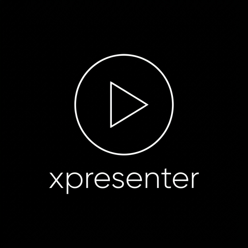

<p align="center"></p>

# xpresenter

Aplicativo desktop (Electron) para projetar **letras de músicas**, **versículos** e **avisos** no culto, com
**controle remoto pelo celular**. Inspirado na experiência de uso de apps como o Spresenter, mas escrito do zero
(nenhum código de terceiros foi copiado).

## Como usar

```bash
npm install
npm start
```

1. **+ Música** cria uma música. Use `[Verso 1]`, `[Refrão]`, `[Ponte]` para marcar seções; linha em branco separa slides.
   Acordes inline como `[Am]` são ignorados na projeção.
2. **Projetar** abre a saída: em tela cheia no monitor externo, ou em janela se houver um só monitor.
3. Clique num slide para colocá-lo ao vivo. Atalhos: `→`/`Espaço` próximo, `←` anterior, `B` preto, `Esc` limpar,
   `1`–`9`/`C`/`E`/`P`/`I`/`F` seção, `F2` editar slide, `Ctrl+Z` desfazer.
4. **Bíblia**: escolha a versão e digite uma referência (`João 3:16-17`, `1 Co 13:4-7`, `Salmo 23`) **ou palavras**
   (`amou o mundo`, `"assim amou Deus"` para frase exata). A busca ignora acentos e maiúsculas. Clique num resultado para
   abrir a passagem; cada verso vira um slide com a versão no rótulo (`João 3:16 · TB`).
   - **Incluídas** (livres): Tradução Brasileira (TB), Almeida 1911 (ALM1911) e Bíblia Livre (BLIVRE, CC BY 3.0 BR, com atribuição
     obrigatória exibida no app). Fonte e licenças em `data/bibles/SOURCES.md`; para atualizar: `npm run bibles`.
   - **Importar** outras versões: botão de importar ou **arraste o arquivo** para a seção Bíblia. Aceita JSON (lista de livros,
     um arquivo por livro como o `damarals/biblias`, ou o formato do app) e **Zefania XML**. Versões importadas podem ser removidas.
   - ARA, ARC, NVI, NAA, NTLH e outras são de editoras: **não vêm no app**. Importe somente arquivos que você tenha o direito de usar.
5. **Culto** é a ordem do culto (músicas e versículos); reordene e remova.
6. **Remoto** mostra um endereço para abrir no celular (mesma rede Wi-Fi). O endereço contém um token novo a cada execução.

## Arranjos e teclas de seção

- **Arranjo** é a ordem das seções de uma música. Escreva cada seção **uma vez só** na letra (o refrão uma vez) e, no editor
  da música, em **Arranjos**, dê um nome e a ordem: `V1 C V2 C P C C`. Siglas: `V1`, `V2`… versos, `C` (ou `R`) refrão,
  `PC` pré-refrão, `P` (ou `B`) ponte, `I` intro, `F` final; ou os nomes inteiros separados por vírgula
  (`Verso 1, Refrão, Coda`). O editor mostra as siglas da letra e avisa o que o arranjo pede e não existe.
- Uma música pode ter até 12 arranjos (ex.: "Culto", "Acústico"). O **primeiro é o padrão** ao abrir e ao adicionar ao culto.
- Nos **Slides**, o seletor de arranjo troca a ordem na hora. Num item do **culto**, a troca fica salva no culto (o celular
  também passa a seguir esse arranjo). "Ordem da letra" volta à ordem em que a letra foi escrita.
- **Cores e teclas por seção**: cada slide tem a cor do tipo (verso azul, refrão vermelho, pré-refrão âmbar, ponte roxo,
  intro verde, final cinza) e o começo de cada seção mostra a tecla. `1`–`9` vão ao verso, `C` ao refrão, `E` ao pré-refrão,
  `P` à ponte, `I` à intro e `F` ao final, **ao vivo**, na próxima vez que a seção aparece depois do slide no ar (no fim,
  volta à primeira). Os botões `V1 C V2 C P…` acima dos slides fazem o mesmo com o mouse; o da seção no ar fica verde.

## Edição rápida, mensagens e desfazer

- **Editar slide**: botão direito no slide (ou `F2` no selecionado) abre só aquele texto. Numa música, a correção vai para a
  **letra** (vale para todas as repetições do trecho e para o culto) e as linhas que não mudaram mantêm os acordes. Num item
  do culto que não é música (versículo, PowerPoint), corrige o slide no culto. Se o trecho está no ar, ele é reenviado
  corrigido. `Ctrl+Enter` salva.
- **Mensagens** (seção no bloco "Aviso e fundo"): modelos com campos entre chaves, como
  `Pais de {criança}, por favor compareçam ao berçário.` Escolha o modelo, preencha os campos e **Mostrar** (ou Enter). Cada
  modelo diz **onde** aparece (tela, retorno de palco, ou os dois) e **por quanto tempo** (10 s a 5 min, ou até tirar). Ao
  esgotar o tempo, só sai se a mensagem no ar ainda for aquela (um aviso que você trocou fica). O app já vem com três
  exemplos (berçário, veículo, tempo para o pregador); até 30 modelos, em `messages.json`.
- **Desfazer** (`Ctrl+Z` ou o botão ↶ no cabeçalho) volta o que estava no ar: slide, tela preta, capa, camadas, fundo,
  e estilo. `Ctrl+Shift+Z` (ou `Ctrl+Y`) refaz. Ações em sequência rápida (tema automático + slide) são um passo só.
  Cronômetro, controle de vídeo, aviso e mensagem do palco não entram no desfazer e ficam como estão (um aviso que já saiu
  do ar não volta). Guarda os últimos 50 passos, só na memória.

## Câmera e placa de captura

Câmera USB, **placa de captura (HDMI)** ou a câmera virtual do OBS como imagem ao vivo. Botão de câmera em **Aviso e fundo**:

- Abre um diálogo com a lista de dispositivos e um **preview**. **Usar como fundo** (a letra aparece por cima) ou **Tela cheia**
  (a câmera ocupa o lugar da letra; `Esc` limpa). **Só imagem, sem som.**
- Cada janela de projeção abre o seu próprio fluxo e **solta a câmera ao trocar de fundo ou limpar** (a luz da câmera apaga).
  Se o dispositivo não abrir (em uso por outro programa, desconectado), a tela fica com o fundo preto em vez de travar.
- O fundo de câmera entra nos **temas** como qualquer fundo. O celular e o retorno de palco não mostram a imagem (só o rótulo
  "CÂMERA"), como acontece com imagens e vídeos de fundo.
- A câmera fica aberta enquanto estiver no fundo ou em tela cheia, mesmo com o fundo oculto, a capa ou a tela preta ligados
  (para voltar na hora). Cada projeção, o Preview e o Programa abrem o seu próprio fluxo do mesmo dispositivo: **algumas placas
  de captura só aceitam uma abertura**; se a imagem ficar preta, teste com uma projeção só e confira no hardware real.
- **Segurança:** o app só libera a **câmera (vídeo)** e **só para as próprias janelas**. Microfone, localização, notificações e
  qualquer outro pedido do navegador embutido são negados.

## Áudio de fundo

Música para **antes do culto**, tocada pelo computador do operador (a saída de som dele). Seção **Áudio** no bloco da biblioteca.

- Adicione faixas pelo botão ou **arrastando** os arquivos (MP3, M4A, AAC, OGG, OPUS, WAV, FLAC; até 100). Reordene com a seta,
  remova com o **x**; faixa cujo arquivo sumiu aparece marcada. Só guarda a referência (não copia arquivos).
- Tocar/pausar, anterior, próxima, **volume** e **Repetir** (volta à primeira no fim da lista).
- **Fade ao entrar o culto** (ligado por padrão): quando o primeiro slide ou vídeo entra ao vivo, a música **baixa em 3 s e para**.
  O botão do alto-falante riscado faz o mesmo na hora. Volume, repetir e fade ficam salvos neste computador.
- **OSC** (Companion, Stream Deck): `/xpresenter/audio/toggle` (tocar/pausar), `/xpresenter/audio/next` e `/xpresenter/audio/fade`.
- O som de **vídeos** continua saindo pela primeira projeção que mostra mídia; o áudio de fundo é separado e não passa pela projeção.

## Props

Elementos **fixos sobre a projeção** que você liga e desliga com um clique, enquanto os slides passam: logo da igreja, QR
do Pix ou das ofertas, faixa com o nome do pregador. Seção **Props** (por padrão no bloco "Culto"; use **+** para criar).

- Cada prop é **imagem** (arquivo local: PNG com fundo transparente funciona bem) ou **texto** de uma linha (até 80
  caracteres), com **posição** (quatro cantos, centro ou faixa inferior) e **tamanho**. Até 30 props salvos em `props.json`
  e até 6 no ar ao mesmo tempo (o mais antigo sai quando entra o sétimo).
- O botão do prop fica aceso enquanto ele está no ar. Se a imagem foi movida ou apagada, o app avisa em vez de projetar vazio.
  Editar um prop que está no ar atualiza o ao vivo.
- Ficam acima da legenda e **abaixo da capa e da tela preta**; **não aparecem nas saídas "só letra"** (telas da banda).
  Não entram no desfazer: `Ctrl+Z` volta o slide, não tira nem traz de volta um prop.
- Imagem só de arquivo local, e texto só como texto (nunca HTML nem CSS), então um `props.json` editado à mão não injeta nada.

## Macros

Um botão que **faz várias coisas de uma vez**. Seção **Macros** (no bloco "Culto"; **+** cria). O app vem com dois exemplos
(**Zerar a tela** e **Contagem para as 19h**).

- **Passos** (lista fechada, na ordem em que você montar): aplicar tema; ligar ou desligar um prop (ou todos); mostrar uma
  mensagem (modelo **sem campos**) ou tirá-la; capa e tela preta (ligar/desligar); limpar o conteúdo; cronômetro (regressiva
  em minutos, até um horário, zerar, iniciar, pausar, mostrar ou esconder na tela). Até 20 passos por macro e 30 macros.
- **Como executar**: clique no botão do macro, `Alt+1` a `Alt+9` (a ordem da lista) ou **OSC** `/xpresenter/macro/N` (N de 1 a 99,
  a posição do macro na lista), para Companion, Stream Deck ou mesa de luz.
- Passos que ligam/desligam (capa, preto, cronômetro) só agem se ainda não estiverem como pedido, então rodar o macro duas
  vezes não inverte nada. Se um passo falha (tema ou prop que não existe mais, imagem sumida), os outros continuam e o app
  diz **quais** falharam.
- O macro inteiro é **um passo só no desfazer** (`Ctrl+Z` desfaz tudo o que ele fez, menos cronômetro, aviso e props, que ficam
  fora do desfazer). Cada passo passa pela mesma validação do resto do app: um `macros.json` editado à mão não faz nada que
  você não faria pela tela.

## Relatório de uso (CCLI)

- Cada música que entra **ao vivo** é registrada **uma vez por dia** (título, autor, número CCLI, data e hora) em `usage.jsonl`
  na pasta de dados. Versículos, mídia e PDF não contam. Passar de slide, voltar ao item ou desfazer não duplica.
- Cadastre o **autor** e o **nº CCLI** no editor da música (o número só aceita dígitos).
- O botão de planilha na seção **Culto** abre o relatório: escolha o período (começa no mês corrente), confira a lista e
  **Exportar CSV…**. O arquivo usa `;` e abre direto no Excel em português; textos que começariam com `=`, `+`, `-` ou `@`
  ganham um apóstrofo, para uma planilha nunca executá-los como fórmula.

## Cronômetro até um horário e efeitos de texto

- No **Cronômetro**, o tipo **Até o horário** conta até um horário do relógio do computador (hoje, ou amanhã se já passou):
  ótimo antes do culto, com a legenda `Começa em {cronometro}`. Não pausa (só **Zerar**, que volta à regressiva de 5 min) e
  fica vermelho e negativo depois do horário. O retorno de palco e o celular acompanham.
- Em **Tema e texto**: **contorno** da letra (fino ou grosso), **caixa escura** atrás do texto (10–80%, para ler sobre vídeo
  claro) e **desfoque** do fundo (imagem ou vídeo). Entram nos temas; temas antigos abrem sem efeitos.

## Preview, Programa e retorno de palco

- **Preview** (azul) mostra o slide selecionado antes de ir ao ar; **Programa** (verde) espelha exatamente a saída.
  Clique seleciona, **duplo clique** / **Enter** / **Ao vivo ▶** envia. Setas e Espaço avançam ao vivo, e o Preview passa a
  mostrar o próximo slide. Marque "Clique envia direto ao vivo" para o modo direto.
- **Retorno de palco** (para banda e pregador): slide atual, próximo, relógio, aviso de tela preta e mensagem livre.
  Abre em tela cheia no monitor escolhido ou em janela. Também funciona em tablet/celular: botão **Remoto** mostra o link.
- **Grade bento**: a tela do operador é uma grade de 12 colunas com blocos de tamanhos variados.
  - **Mover bloco**: arraste a alça ⠿ do bloco sobre outro (ele toma o lugar do alvo), ou foque a alça e use as setas.
  - **Redimensionar**: arraste o canto ◢ (encaixa nas células da grade), ou foque o canto e use as setas; duplo clique restaura.
  - **Mover seção**: cada seção (Músicas, Bíblia, Preview, Programa, Slides, Controles, Retorno, Culto) tem a alça ⋮⋮.
    Arraste para outro bloco, antes/depois de outra seção, ou para um bloco vazio. Pelo teclado: ↑ ↓ reordena dentro do
    bloco e ← → manda para o bloco anterior/seguinte. Seções também recolhem.
  - **Restaurar layout** volta a tudo ao padrão. O layout (blocos, tamanhos e seções) fica salvo. Seções novas de versões
    futuras entram no bloco padrão sem desfazer o seu arranjo.
- **Presets de layout** (seletor **Layout** no cabeçalho): troca o arranjo inteiro com um clique.
  - **Padrão**, **Culto** (monitores grandes no topo, slides e controles embaixo), **Ensaio** (biblioteca e slides em
    destaque) e **Operador de mídia** (monitores e controles em faixa, retorno e slides abaixo). Todos preenchem a grade
    12×12 sem buracos.
  - **Salvar layout…** guarda o arranjo atual com um nome (até 20; mesmo nome substitui). **Excluir** pede confirmação com
    um segundo clique. Se você mexer no arranjo, o seletor mostra **Personalizado**. Trocar de preset não altera o que
    está ao vivo.

## Cabeçalho e modo "editar painéis"

- O cabeçalho é uma linha de ícones em grupos: **ao vivo** (anterior, próximo, limpar, preto, capa), **layout** (seletor de
  preset, salvar, excluir, restaurar e **editar painéis**) e **saída** (controle remoto e Projetar).
- As alças de **mover bloco**, **mover seção** e **redimensionar** ficam **ocultas** por padrão. Clique em **editar painéis**
  (ícone de painéis, no grupo Layout) para mostrá-las; o botão fica azul e os blocos ganham contorno tracejado. Clique de novo
  para concluir. Com o modo desligado, mover e redimensionar ficam desativados de fato (teclado e arrastar incluídos).
- O modo **não é salvo**: o app sempre abre travado, para ninguém desmontar a tela no meio do culto. O layout editado é mantido.
- Trocar de preset, salvar e restaurar layout funcionam sem ligar o modo de edição.

## Interface compacta com ícones

Os botões usam ícones minúsculos (14 px; 12 px nos menores) no estilo de apps de projeção como o Spresenter, com o texto só
nos botões principais (`Projetar`). Todo botão só de ícone tem `title` (dica ao passar o mouse) e `aria-label`. Os ícones são do
[Lucide](https://lucide.dev) (licença ISC, em `licenses/lucide-LICENSE.txt`), embutidos em `src/renderer/shared/icons.js` só com
os usados. Para trocar ou acrescentar: edite a lista em `scripts/build-icons.js` e rode `npm run icons` (gera também a cópia
em `src/remote/icons.js`, usada pelo controle remoto do celular e pelo retorno de palco).

O ícone do app (instalador, barra de tarefas, controle remoto) é gerado a partir de `logo/logo-xpresenter.png` com
`npm run app-icon`: usa só o símbolo, com o traço engrossado para ficar legível em 16–32 px.

## Busca de músicas e letras da internet

- A busca de **Músicas** procura no **título e na letra**, sem diferenciar acentos e maiúsculas, pelo início das palavras
  (`aguas` acha "águas", `perd` acha "perdoar"). Use `"entre aspas"` para frase exata. Quem foi achado pela letra mostra a
  linha encontrada abaixo do título. Marcadores de seção e acordes não entram na busca.
- **Buscar letra na internet** (ícone de globo, ou o atalho que aparece quando nada é encontrado na biblioteca): digite o nome
  e, se quiser, o artista. As letras vêm do [LRCLIB](https://lrclib.net), uma base aberta e gratuita mantida pela comunidade,
  sem cadastro. Resultados repetidos são agrupados. Escolha um, confira a letra e clique em **Revisar e salvar…**: ela abre
  no editor para você marcar as seções (`[Refrão]`…) antes de salvar.
- Letras de músicas têm direitos autorais. Projete só o que sua igreja tem licença para usar (ex.: CCLI).
- Se o serviço estiver ocupado ou sem internet, o app avisa e não trava; a busca na biblioteca continua funcionando offline.

## Camadas: ocultar letra, fundo e aviso

- No cabeçalho, o grupo **Camadas** oculta e mostra a **letra** (atalho `L`), o **fundo** e o **aviso** sem perder o
  conteúdo: a letra volta no mesmo slide, o aviso volta com o mesmo texto. Botão aceso = camada oculta.
- Enviar outro slide ao vivo volta a mostrar a letra. Trocar o fundo mantém se ele está oculto.
- **Escurecer** (em "Aviso e fundo"): 10% a 80% de escurecimento sobre a imagem ou o vídeo, para a letra ler melhor.
- O retorno de palco mostra "LETRA OCULTA" enquanto a letra estiver escondida.

## Transmissão (OBS / vMix)

O botão de controle remoto mostra também o endereço da **Transmissão** (`/live.html?t=…`): uma página com **fundo
transparente** e a letra ou o versículo ao vivo numa faixa inferior. No OBS, adicione uma **Fonte de navegador**
(Browser Source) de 1920×1080 com esse endereço; no vMix, uma entrada **Web Browser**. Para softwares sem transparência,
acrescente `&fundo=verde` e use chroma key. A faixa some com tela preta, letra oculta ou conteúdo limpo.

- `&modo=tela`: a letra em **tela cheia** (com cor, fonte e maiúsculas do tema) sobre fundo transparente, em vez da faixa.

### NDI (pelo OBS)

O app não embute o SDK da NDI (licença proprietária). Use o OBS como ponte, de graça:

1. Instale o [OBS Studio](https://obsproject.com) e o plugin [DistroAV](https://github.com/DistroAV/DistroAV) (antigo obs-ndi),
   que instala também o NDI Runtime.
2. Monte a cena no OBS:
   - **Só a letra** (para sobrepor na mesa de vídeo): **Fonte de navegador** 1920×1080 com o endereço de Transmissão
     (`…/live.html?t=…&modo=tela` para tela cheia, ou sem `modo` para a faixa inferior). O fundo é transparente: o NDI
     leva o canal alfa.
   - **A projeção inteira** (fundo, vídeos, PDF): **Captura de janela** da janela "xpresenter - Saída" (ou de tela, se a
     saída estiver em tela cheia num monitor).
3. Em **Ferramentas → Configurações do DistroAV**, ligue a **Saída principal NDI** (ou use o filtro "NDI Output" só numa
   fonte). A mesa de vídeo, o vMix ou outro computador passam a ver o "OBS" como fonte NDI na rede.

## Fundo, estilo do texto e temas

Nas seções **Aviso e fundo** (cor, imagem, vídeo) e **Tema e texto** (estilo, temas):

- **Fundo**: cor, imagem ou **vídeo** (MP4, WebM, M4V, OGV; toca em loop e sem som). Só arquivos locais.
- **Estilo do texto**: fonte (sem serifa, serifada, condensada, slab; só fontes do sistema, funciona sem internet), tamanho
  máximo (50–150%, o texto continua encaixando automaticamente), cor, alinhamento, posição (topo, meio, base), tudo em
  maiúsculas, sombra e rótulo (Verso, Refrão, referência). Vale na saída, no Preview e no Programa na hora.
- **Temas**: **Salvar tema** guarda o fundo e o estilo que estão na saída agora, com um nome (até 30; mesmo nome substitui).
  Escolher um tema aplica os dois de uma vez, sem mexer no slide ao vivo. Se você mudar algo, o seletor mostra
  "Sem tema (personalizado)". Excluir pede um segundo clique.
- O app **reabre com o último fundo e estilo** usados (arquivo `themes.json` na pasta de dados do app).
- O controle remoto do celular não altera fundo nem estilo. Os valores do estilo são fechados (listas, cor hex e números),
  então um `themes.json` editado à mão não consegue injetar CSS: campos inválidos voltam ao padrão.

## Biblioteca de mídia

Seção **Mídia** (no bloco da biblioteca): imagens (JPG, PNG, WebP, GIF) e vídeos (MP4, WebM, M4V, OGV) com miniaturas.
- **Adicionar**: botão de importar (vários de uma vez) ou **arraste os arquivos** para a seção. O app guarda só a referência
  (não copia vídeos grandes); se o arquivo for movido ou apagado, o cartão aparece como "arquivo não encontrado".
- **Clique** na miniatura: vira o **fundo** (imagem ou vídeo em loop, sem som).
- **▶ (tela cheia)**: mostra a imagem ou o **vídeo com som** no lugar da letra. Sob o Programa aparecem pausar/tocar,
  voltar ao início e a barra de progresso. Mandar um slide ou limpar (Esc) encerra o vídeo.
- **Adicionar ao culto**: o vídeo/imagem vira um item do culto, enviado ao vivo como qualquer slide.
- Só a primeira janela de projeção toca o som; Preview e Programa ficam mudos. O retorno de palco mostra "AGORA · VÍDEO".
- O app desliga a economia de energia do Chromium para vídeo e relógios não pararem com a janela encoberta.

## Várias saídas, panorâmico e edge blending

Botão **Configurar saídas** (ícone de monitor com engrenagem, no grupo Saída):
- Marque os monitores que projetam e **o que cada um mostra**: **Tudo**, **Só letra** (sobre preto: telas laterais, tela da
  banda, captura) ou **Só fundo e mídia** (tela de ambiente). Sem nenhum marcado, cada monitor externo mostra tudo, como antes.
- **Panorâmico** (2 a 4 telas): uma imagem larga dividida entre os monitores, na posição 1, 2, 3… de cada um.
  - **Sem sobreposição**: recorte simples, para **painéis de LED** lado a lado.
  - **Com sobreposição** (5% a 30%): para projetores que cruzam a imagem. As bordas internas ganham **edge blending**
    (rampa corrigida por gama 2,2) para a emenda não aparecer. Ajuste a porcentagem até a faixa sobreposta ficar com o mesmo
    brilho do resto.
- Salvar com a projeção aberta reabre as janelas no novo arranjo. O som dos vídeos sai só pela primeira saída que mostra mídia.

## Automação (OSC) e avanço automático

Botão **Automação** (grupo Saída):
- **Receber comandos OSC** (Bitfocus Companion, Stream Deck, TouchOSC, mesa de luz): desligado por padrão. Ligado, escuta só
  **este computador** (127.0.0.1) na porta escolhida; marque "de qualquer aparelho da rede" só em rede confiável (OSC não tem
  senha). Comandos aceitos (lista fechada): `/xpresenter/next`, `/prev`, `/clear`, `/black`, `/cover`, `/lyrics`,
  `/background`, `/timer/toggle`, `/timer/reset`, `/media/play`, `/media/pause`, `/media/restart`. No máximo 100 mensagens
  por segundo.
- **Regras de saída**: "quando **slide ao vivo / item novo / tela preta liga ou desliga / conteúdo limpo / vídeo no ar**,
  enviar o endereço OSC X (com argumentos) para IP:porta". Ex.: item novo → `/cue/5/go` para a mesa de luz.
- **Avanço automático** (seção Slides): a cada 3 s a 1 min, com **Loop** para avisos rodando antes do culto. Avançar à mão
  reinicia a contagem; sem loop, para no último slide. Com **tela preta**, **letra oculta** ou conteúdo **limpo**, o avanço
  espera (não traz o slide de volta). Abrir **outro item** desliga o avanço automático.
- `next`/`prev` por OSC seguem o slide que está **no ar** (inclusive se foi escolhido pelo celular); o operador acompanha.
- Vídeo, imagem ou página de PDF cujo **arquivo sumiu** não vai ao ar: o operador vê "Arquivo não encontrado" e o celular
  recebe erro, em vez de a projeção ficar vazia.

## Importar apresentação (PDF e PowerPoint)

Botão de apresentação na seção **Culto**:
- **PDF**: cada página vira um slide de imagem (1920 px de largura) e o arquivo entra no culto como um item. Ideal para os
  slides do pregador: no PowerPoint/Google Slides/Keynote, **exporte como PDF** e importe aqui. Até 300 páginas, 100 MB.
  As páginas ficam na pasta de dados do app e são apagadas quando o item sai do culto.
- **PPTX**: importa só o **texto** de cada slide (como slides de texto, no estilo do tema). Para manter o visual, use PDF.
- O PDF é renderizado com o [pdf.js](https://mozilla.github.io/pdf.js/) (Apache-2.0, cópia em `src/renderer/vendor/pdfjs`;
  atualizar com `npm run vendor:pdfjs`). O PPTX é lido com o [fflate](https://github.com/101arrowz/fflate) (MIT), com limites
  contra arquivos que se expandem demais.

## Transições, legenda e tema automático

- **Transição** (em "Tema e texto"): corte seco ou fade (rápido, normal, lento, muito lento). No fade, o slide
  anterior some enquanto o novo aparece (crossfade). A transição faz parte do tema.
- **Legenda**: uma linha num canto da tela, com variáveis: `{titulo}` (música ou passagem), `{rotulo}` (Verso, Refrão…),
  `{hora}`, `{data}` e `{cronometro}`. Ex.: `{titulo} · {hora}` ou `Faltam {cronometro}`. Variável vazia some junto com o
  separador. Enter ou sair do campo aplica. Também faz parte do tema.
- **Tema automático**: escolha o tema das **músicas** e o dos **versículos**. Quando um item novo entra ao vivo, o tema dele é
  aplicado antes do primeiro slide. Cada música pode ter **tema próprio** (no editor da música), que vale mais que o padrão.
  Avançar dentro do mesmo item não reaplica, então ajustes feitos à mão durante a música são mantidos.

## Cronômetro

Na seção **Cronômetro**: **regressiva** (minutos) ou **cronômetro** (conta para cima), com iniciar/pausar e zerar.
- **No retorno** aparece no cabeçalho sempre que estiver em uso: amarelo no último minuto, vermelho e negativo quando estoura
  (ex.: `-01:20`, tempo da pregação). Em tablet, usa o relógio do computador do operador, não o do aparelho.
- **Na projeção**, só se você ligar o botão de TV: grande no centro quando não há letra (contagem antes do culto, inclusive
  sobre a capa) e pequeno no canto quando há letra. Também pode entrar na legenda com `{cronometro}`.

## Camadas da projeção

Fundo (cor/imagem/vídeo) → Conteúdo (slide) → Legenda → Capa → Cronômetro → Aviso (rodapé) → Preto. Estado central em
`src/core/state.js`. `src/renderer/shared/liveInfo.js` (cronômetro e variáveis da legenda) tem uma cópia idêntica em
`src/remote/` (o servidor remoto só serve aquela pasta); um teste confere.

## Arquitetura

```
src/core/      lógica pura e testada (songParser, songEdit, songSearch, lyricsOnline, bible, state, textStyle, themeLibrary, store, library, messages, remoteServer)
src/main/      processo principal Electron (janelas, IPC, preload)
src/renderer/  operator/ (operador), output/ (projeção), shared/ (palco reutilizado por saída, Preview e Programa; layoutModel.js com o modelo puro da grade bento; sections.js com tipos, teclas e siglas das seções)
src/remote/    controle remoto, retorno de palco e página de transmissão (HTTP + SSE, sem dependências)
```

## Testes

```bash
npm test            # unitários/integração
npm run coverage    # com cobertura
```

## Segurança do controle remoto

HTTP simples em rede local, com token de 128 bits por execução, bloqueio após 10 tentativas erradas e lista de ações
permitidas. Use apenas em Wi-Fi confiável.

- O celular **não envia conteúdo**: ao tocar num slide ele pede "item X, slide N" e o computador busca o slide no culto salvo
  (aplicando o **tema automático** do item, como o operador). Assim ninguém com o link injeta texto nem caminho de arquivo.
- Pode: anterior/próximo, limpar, preto, capa, **ocultar letra**, aviso, mensagem do palco, **cronômetro** (iniciar, pausar,
  zerar) e **vídeo** (tocar, pausar, do início). Não pode: fundo, estilo/tema, mostrar cronômetro na projeção, camadas de
  fundo, saídas, automação.

## Instalação e atualização automática

- Baixe o instalador `xpresenter-Setup-x.y.z.exe` em [Releases](https://github.com/astonishslim/xpresenter/releases).
  O instalador ainda **não é assinado**: na primeira vez o Windows mostra "O Windows protegeu o computador" → **Mais
  informações → Executar assim mesmo**.
- O app instalado procura versões novas no GitHub (15 s depois de abrir e a cada 6 h) e **baixa em segundo plano**. A
  atualização é instalada **quando você fecha o app**; ele nunca reinicia sozinho no meio do culto. Para atualizar na hora,
  use o botão verde **Atualizar** no cabeçalho (dois cliques). Sem internet, nada muda.
- Para publicar uma versão: aumente `version` no `package.json`, rode `npm run dist` e crie a release `vX.Y.Z` no GitHub com
  os três arquivos de `dist/`: o `.exe`, o `.exe.blockmap` e o `latest.yml`.
- O app se chamava **Apresentador** até a 0.2.0. Ao atualizar, os dados (músicas, temas, layout) passam de
  `%APPDATA%\Apresentador` para `%APPDATA%\xpresenter` sozinhos, e os comandos OSC `/apresentador/...` continuam valendo.

## Licença

Código sob a licença [MIT](LICENSE). Componentes de terceiros mantêm as próprias licenças (pasta `licenses/` e
`data/bibles/SOURCES.md`): ícones Lucide (ISC), pdf.js (Apache-2.0), fflate (MIT) e Bíblia Livre (CC BY 3.0 BR, com
atribuição exibida no app). TB e Almeida 1911 são de domínio público.

## Próximos passos sugeridos

NDI nativo (hoje via OBS + DistroAV; nativo depende do SDK proprietário da NDI), atualização automática do instalador (precisa de um lugar para
publicar as versões, ex.: GitHub Releases, e de preferência certificado de assinatura de código), efeitos visuais e linha
do tempo completa.
